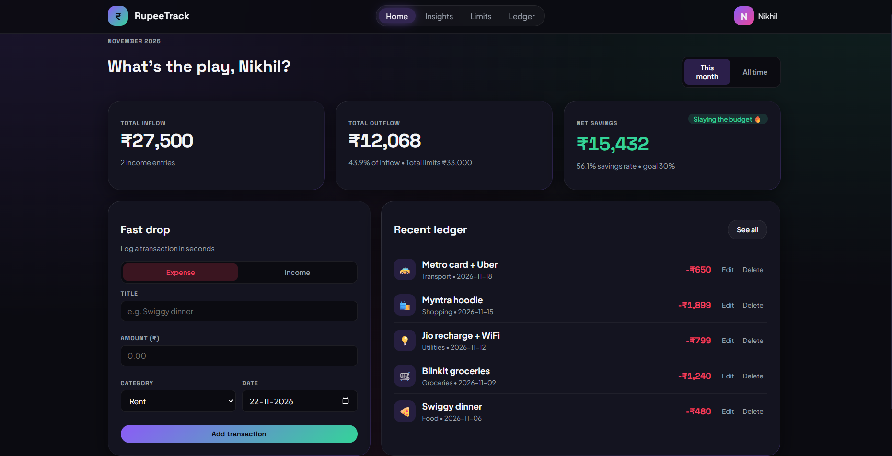
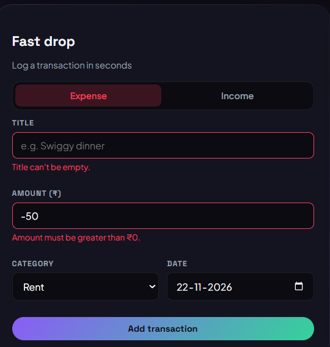
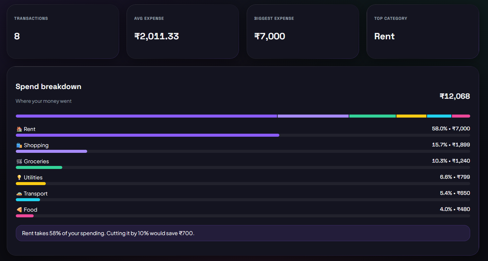
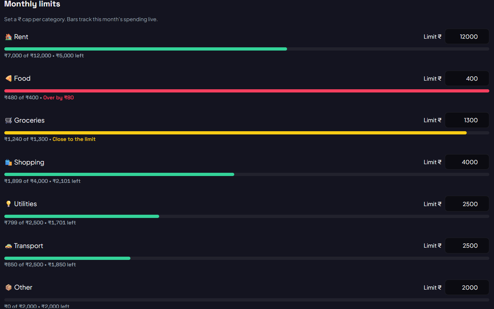
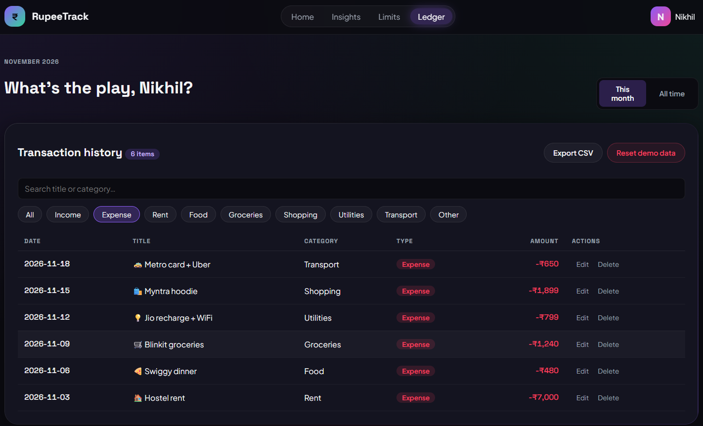
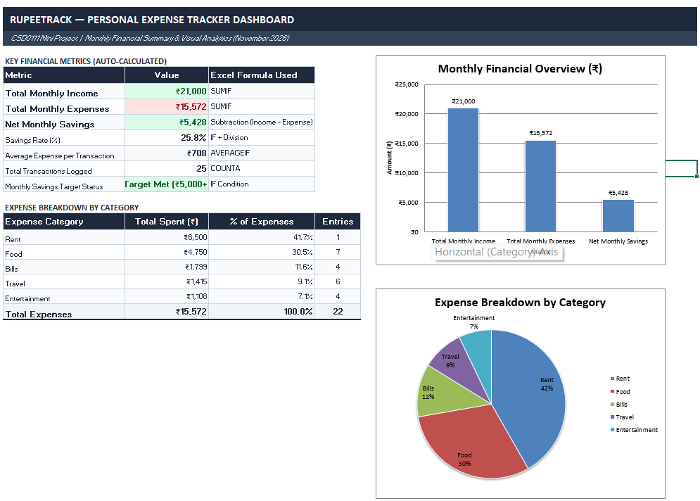

<div align="center">

# ₹ RupeeTrack — Personal Expense Tracker

**A Modern, Offline-First Personal Finance & Monthly Savings Analytics System**


</div>

---

## Student Details

| Field | Details |
| :--- | :--- |
| **Student Name** | Nikhil Bhadouria |
| **Roll Number** | `BETN1CS26135` |
| **Program & Semester** | B.Tech CSE – Semester I |
| **Institution** | ITM University Gwalior |
| **Course** | CSD0111 – Project Studio-I (Mini Project) |
| **Academic Session** | July–December 2026 |

---

## Project Overview

**RupeeTrack** is a lightweight, privacy-first, browser-based Personal Expense Tracker built for Indian students and young professionals (formatted in **INR ₹**). Designed as an integrated mini-project for **CSD0111 – Project Studio-I**, it brings together all six mandatory syllabus technologies—**HTML5, CSS3, Vanilla JavaScript, MS Excel, MS Word, and MS PowerPoint**—into a practical, real-world solution.

Unlike static pages or bloated finance apps that require bank linking, RupeeTrack runs **100% offline in the browser** using `localStorage`, recalculates all financial metrics dynamically, enforces monthly category spending caps, and pairs with an automated MS Excel analytics workbook.

---

## Key Features

### Web Application (`04_Website/`)
- **4-Tab Single-Page Interface:** Smooth JavaScript tab switching across **Home**, **Insights**, **Limits**, and **Ledger** without page reloads.
- **Strict Form Validation:** Blocks empty titles, missing dates, or amounts `≤ ₹0` with clear inline red error messages.
- **Full CRUD Operations:** Add new income/expenses via the *Fast Drop* form, edit any existing entry, or delete transactions with confirmation.
- **Real-Time Metrics & Vibe Check Badge:** Dynamically calculates Total Inflow, Total Outflow, Net Savings, and Savings Rate (`%`), updating a live status badge (e.g., *Slaying the budget 🔥* at `≥30%` savings).
- **Interactive Monthly Category Limits:** Set editable ₹ caps per category with color-coded progress bars (green `<80%`, amber `80–100%`, red `>100%`) and automatic over-budget toast alerts.
- **Live Search & Filter Chips:** Instantly filter the semantic HTML transaction table by keyword, transaction type (`Income`/`Expense`), or category.
- **Data Export & Persistence:** Saves all state to `localStorage`, supports one-click **CSV / Excel export**, and includes a **Reset demo data** button.
- **XSS-Safe Rendering:** All user-entered text passes through an `esc()` HTML sanitizer before rendering to the DOM.

### MS Excel Analytics (`02_Excel_Workbook/Project_Data.xlsx`)
- **2 Organized Sheets:** `Dashboard` (executive summary + charts) and `Transactions` (25 realistic November 2026 student records).
- **7 Live Formulas:** `SUMIF`, `AVERAGEIF`, `COUNTA`, `COUNTIF`, `IF`, `SUM`, and Net Savings calculation (`₹21,000` Income | `₹15,572` Expenses | `₹5,428` Savings | `25.8%` Savings Rate).
- **2 Embedded Charts:** Monthly Financial Overview Column Chart and Category Expense Pie Chart.

---

## Screenshots

### Home Dashboard & Live KPIs


| Form Validation | Insights Breakdown |
| :---: | :---: |
|  |  |

| Monthly Category Limits | Searchable Ledger |
| :---: | :---: |
|  |  |

### MS Excel Analytics Dashboard


---

## Project Folder Structure

```text
CSD0111_Mini_Project/
├── 01_Word_Documentation/
│   ├── Project_Report.docx
│   └── Project_Report.pdf
├── 02_Excel_Workbook/
│   └── Project_Data.xlsx
├── 03_PowerPoint/
│   └── Project_Presentation.pptx
├── 04_Website/
│   ├── index.html
│   ├── style.css
│   ├── script.js
│   └── images/
├── 05_Screenshots/
│   └── Project_Screenshots/
│       ├── 01_home_dashboard.jpg
│       ├── 02_form_validation.png
│       ├── 03_insights_breakdown.png
│       ├── 04_monthly_limits.png
│       ├── 05_ledger_search_filter.png
│       └── 06_excel_dashboard.png
└── README.md
